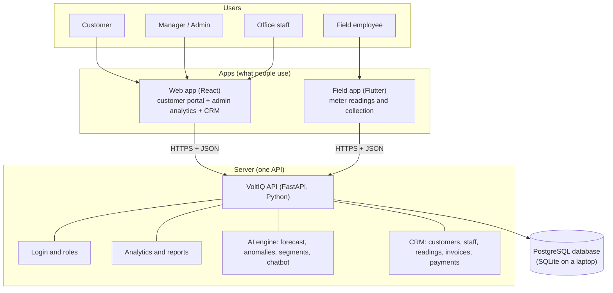
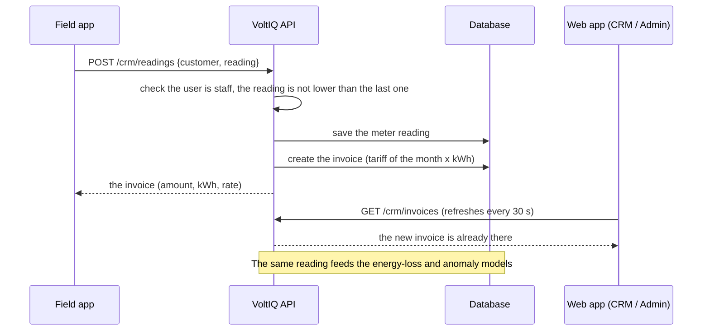

# VoltIQ Architecture

This document explains **how VoltIQ is built**, **what each part does**, and
**why we chose it**. It is written in simple English on purpose.

VoltIQ started as three separate pieces from the NXTTRN × MUBS internship:

1. **Energy Analytics**: a website plus a Python API, for customers and for the company's managers.
2. **Utility CRM (web)**: a separate website for office staff, using its own database on Supabase.
3. **Field app (mobile)**: a Flutter phone app for meter readers, also using Supabase.

These three pieces did not share data. A reading taken on the phone did not reach
the analytics. Each piece had its own login. A small launcher started them side by side.

**VoltIQ joins them into one system:** one API, one database and one login, used by every app.

---

## 1. The big picture



**In one sentence:** every app talks only to the API, and only the API talks
to the database.

That single rule is the most important decision in this document. It means:

- The data has **one source of truth**. A reading saved on a phone is already
  an invoice in the CRM and a data point for the AI.
- **Security is in one place.** The API checks who you are and what you may
  do, for every request, from every app.
- We can **change or add an app** (for example a customer mobile app) without
  touching the database.

---

## 2. The components, one by one

### 2.1 Web app: `frontend/`

| | |
|---|---|
| **What it is** | One website with three areas: the **customer portal** (`/app`), the **admin analytics** (`/admin`) and the **CRM** (`/crm`). |
| **Built with** | React 18, TypeScript, Vite, Tailwind CSS, React Router, Chart.js and Recharts. |
| **Who uses it** | Customers, managers, office staff. |

**Why React + TypeScript + Vite?**
- The analytics website was already built this way and works well.
- React is the most common web UI library, so new developers can join easily.
- TypeScript catches many mistakes before the code runs.
- Vite builds a fast, **static** website (plain HTML, CSS and JavaScript files),
  which can be hosted for free on GitHub Pages.

**Why we merged the CRM into the same web app** instead of keeping two websites:
- One login, one address, one design.
- An admin can jump between analytics and CRM with one click.
- The CRM screens were kept almost as they were. They live in
  `frontend/src/modules/crm/`. We changed only how they get their data:
  they now call the API instead of Supabase.

Which area a person sees depends on their **role**, and the API checks the
role again on every request.

| Role | Lands on | Can open |
|---|---|---|
| `customer` | `/app` | Own consumption, bills, payments, tips, chatbot |
| `admin` | `/admin` | Everything: analytics, AI, reports, and the CRM |
| `staff` (office) | `/crm` | CRM: customers, employees, billing, payments |
| `field` (meter reader) | `/crm` and the field app | Assigned customers, readings, collection |

### 2.2 Field app: `mobile/`

| | |
|---|---|
| **What it is** | A phone app for field employees: see your assigned customers, read the meter (camera + text recognition), and the server issues the invoice. |
| **Built with** | Flutter (Dart), Google ML Kit text recognition, camera. |
| **Talks to** | The VoltIQ API, through `lib/services/api_service.dart`. |

**Why Flutter?** It was already built, and one codebase runs on Android and iPhone.

**What we changed:** the app used to talk to Supabase. Now it uses the same API
as the website. We also removed two risky things:
- a hidden admin login written in the app's code;
- price calculation on the phone. The **server** now calculates every bill
  from the official tariff, so the phone and the office always show the same amount.

### 2.3 API: `backend/`

| | |
|---|---|
| **What it is** | The brain of the system. It receives requests from the apps, checks the user, applies the business rules, runs the AI, and reads or writes the database. |
| **Built with** | Python 3.11, FastAPI, SQLAlchemy, Pydantic. |
| **Address** | `http://localhost:8000` on your laptop. Live documentation is at `/docs`. |

**Why Python + FastAPI?**
- The AI part (forecasting, anomaly detection, segmentation) uses Python
  libraries (scikit-learn, statsmodels, pandas). Keeping the API in the same
  language means no second server just for AI.
- FastAPI is fast and simple, and it **writes the API documentation by itself**
  (open `/docs`), so the web and mobile developers can see every endpoint.
- It was already built and tested in the internship (more than 150 tests).

The API is split into **modules** (folders in `backend/app/routers/`):

| Module | Address | What it does |
|---|---|---|
| Auth | `/auth/*` | Sign in, register with a code, password reset and change |
| Customer portal | `/dashboard/customer`, `/consumption`, `/bills`, `/payments`, `/alerts`, ... | A customer's own data |
| Analytics | `/analytics/*`, `/revenue/*`, `/customers`, `/dashboard/admin` | Company-wide numbers, regions, revenue, customer accounts |
| AI | `/ai/*`, `/chat/*`, `/ishtirak/ask` | Forecasts, anomalies, segments, recommendations, chatbot |
| Ishtirak (energy loss) | `/ishtirak/*` | Generator output vs. billed energy, loss per zone |
| **CRM** (new) | `/crm/*` | Customers (subscribers), employees, assignments, meter readings, invoices, payments, tariff |
| Reports | `/reports/*` | PDF and Excel exports |

**The CRM module** (`backend/app/routers/crm.py`) is the new part. It
works on the **same tables** the analytics already used (subscribers, meters,
meter readings, invoices, payments, tariffs), plus a new `employees` table.
That is what connects the three original projects.

### 2.4 Database

| | |
|---|---|
| **What it is** | Where all data lives: customers, meters, readings, invoices, payments, staff, AI results. |
| **Production** | PostgreSQL. |
| **On a laptop** | SQLite (a single file, no installation). |
| **Access** | Only through the API, using SQLAlchemy. |

**Why PostgreSQL?** It is free, very reliable, used by large companies, and
every cloud supports it. Later it lets us keep different companies' data
apart (see the roadmap below).

**Why SQLite on a laptop?** Zero setup. A new developer can run the whole
system in minutes. The code is the same for both. Only one setting
(`DATABASE_URL`) changes.

**Why we removed Supabase:** the CRM and the phone app had their own Supabase
database. That meant two copies of the customers, two logins and two sets of
rules. It also tied the product to one outside company. With everything in
one PostgreSQL database behind our API, we own the data and the rules. We can
also install the product on a customer's own server.

### 2.5 Login and security

- **One login for everyone.** Customers, admins, office staff and field staff
  all sign in with the same `/auth/login`.
- After sign-in, the API gives the app a **token (JWT)**. The app sends it
  with every request. The token says who you are and your role.
- Passwords are stored only as **bcrypt hashes**, never as plain text.
- The API checks the **role** on every request (`require_admin`,
  `require_staff`, `require_office` in `backend/app/core/deps.py`). Hiding a
  button in the app is only for convenience. The real protection is on the server.
- **What we removed for safety:** the old CRM kept staff passwords in the
  browser's storage and had a "switch user" menu. The old phone app had a
  hard-coded admin password. All of these are gone.

### 2.6 AI engine: `backend/app/ai/`

| Feature | Method | Why this method |
|---|---|---|
| Demand forecast | SARIMA (statsmodels) | Good for monthly data with seasons (summer/winter) |
| Customer segments | K-Means (scikit-learn) | Simple, explainable groups |
| Anomalies (possible theft or faults) | Isolation Forest + rules | Works without labelled "theft" examples |
| Recommendations, alerts | Rules on the customer's own data | Clear and explainable advice |
| Chatbot / "ask the data" | Rules + search in company documents (RAG), optional OpenAI model | Works with no AI key; better answers with one |

**Why simple, classic models?** They run on a small server, they need little
data, and a manager can understand **why** a customer was flagged. That
matters before anyone is accused of stealing electricity.

### 2.7 Hosting and tools

| Tool | Used for | Why | Cost |
|---|---|---|---|
| **GitHub** | Code, history, reviews | The team already uses it | Free |
| **GitHub Actions** | Runs the tests and builds on every push (`.github/workflows/ci.yml`) | Catches breakage before it reaches users | Free minutes |
| **GitHub Pages** | Hosts the **web app** online (`.github/workflows/pages.yml`) | Free, automatic on every push | Free (needs a public repo or a paid plan) |
| **Render** | Hosts the **API + PostgreSQL** (`render.yaml`) | GitHub Pages cannot run Python, so the API must live somewhere else. Render has a free tier and reads our file automatically | Free tier (sleeps when idle; free database expires after 30 days) |
| **GitHub Codespaces** | Runs the **whole system in the browser** for development or a quick demo (`.devcontainer/`) | Nothing to install | Free monthly hours for personal accounts |
| **Docker Compose** | Installs the whole system **on one server** (`docker-compose.yml`) | This is the "stand-alone product" install for a customer | Free |

See [DEPLOYMENT.md](DEPLOYMENT.md) for the exact steps.

---

## 3. How the data flows: one meter reading

This shows why the single API matters:



---

## 4. Folder map

```
Volt-IQ/
├── backend/                 API (FastAPI)
│   ├── app/
│   │   ├── routers/         one file per module (auth, crm, analytics, ...)
│   │   ├── models/          database tables
│   │   ├── schemas/         request/response shapes
│   │   ├── ai/              AI engine
│   │   ├── rag/             chatbot document search
│   │   ├── pipeline/        data loading and demo data (seed.py, crm_seed.py)
│   │   └── core/            security, roles, settings helpers
│   └── tests/
├── frontend/                Web app (React)
│   └── src/
│       ├── pages/           customer and admin pages
│       ├── modules/crm/     the CRM module
│       ├── services/api.ts  every call to the API
│       └── routes/          who may open which page
├── mobile/                  Field app (Flutter)
├── deploy/                  Dockerfiles and nginx for the stand-alone install
├── docs/                    this document, deployment guide, old internship notes
├── .github/workflows/       CI and GitHub Pages
├── .devcontainer/           GitHub Codespaces setup
├── docker-compose.yml       stand-alone install
└── render.yaml              free API + database hosting
```

---

## 5. From internship project to product: the roadmap

The work so far is **Phase 1: one system.** The next phases turn it into
something you can sell as **stand-alone** (installed for one company) or as
**SaaS** (we host it for many companies).

| Phase | Goal | Main work | Status |
|---|---|---|---|
| **1. One system** | One API, one database, one login | Merge the CRM and the field app into the API; remove Supabase; CI; free hosting | **Done** |
| **2. Many companies (multi-tenant)** | One installation serves many electricity providers, each seeing only its own data | Add a `companies` table and a `company_id` on every table; PostgreSQL row-level security; a "company" claim in the login token; per-company settings (currency, tariff, logo, languages) | Next |
| **3. Packaging and selling** | Easy install and paid plans | Docker images on GitHub Container Registry; licence key that switches modules on/off (stand-alone); plans and online payment (SaaS); automatic backups and monitoring | Later |
| **4. Scale** | More customers, more data | Background job queue (Celery + Redis) for AI jobs; database migrations (Alembic); smart-meter data connectors; email/SMS delivery | Later |

**Why this order?** Phase 1 had to come first: you cannot sell one product
while it is still three systems with three databases. Phase 2 is the change
that makes SaaS possible, and it is much easier now that there is only one database.

---

## 6. Known limits today (honest list)

- **One company per installation.** Multi-company (SaaS) is Phase 2.
- **No database migrations tool yet.** New columns are added by a small
  built-in step at start-up (`backend/app/database.py`). Alembic is planned.
- **The CRM web screens poll every 30 seconds** instead of live push updates.
- **The field app was converted without a Flutter build on this machine.**
  Run `flutter pub get` and `flutter run` once to confirm (see `mobile/README.md`).
- **The Docker install was written but not run** in this environment (no Docker here).
- **GitHub Pages hosts only the web app.** The API needs Render (or another
  host) to be fully online. See [DEPLOYMENT.md](DEPLOYMENT.md).
- **Large lists** (thousands of customers) load in one request. Paging is a next step.
